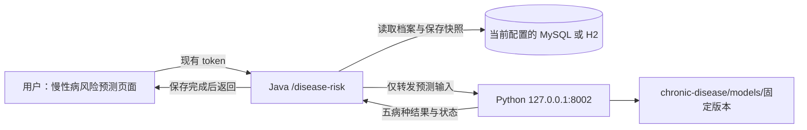

# 五病种风险预测前后端接入实施方案

更新日期：2026-10-15。四张增量表、七个Java接口、Vue页面和固定优化版本的Python服务已实现。MySQL业务库已执行增量建表；H2演示模式也已验证保存、预测和历史读取。本文保留设计约束，并在末尾记录实际交付与验证情况。

## 1. 接入后的使用流程

老人登录现有网站，在用户菜单打开“慢性病风险预测”，填写健康资料与五项疾病史，保存后点击预测。页面显示高血压、糖尿病、卒中、心脏病发作和骨质疏松的五张结果卡，以及本人的历史记录。所有资料直接展示：年龄为保存必填、性别为预测必填；五项健康生活资料在预测时至少填两项，其余逐项标为选填。疾病史未知或已有病史的项目单独跳过；页面在提交前列出条件缺失与本次可预测病种数。

五项结果彼此独立，一个人可以同时有多项风险；概率不归一化，也不要求合计100%。已有某病史时，该病返回“已有病史”，其他病仍按资料情况评估。未知病史、超出年龄、资料不足、模型不可用分别显示原因，不能把缺失结果展示为0%。

这次接入定位为项目研究演示。当前模型估计历史美国完成随访生存者在1987→1992调查间隔内的新报告概率，尚未验证中国社区老人的实际风险。页面使用“研究模型估计”，不把调查间隔写成精确未来五年，不输出确诊或用药结论。

## 2. 当前代码与新增职责

已存在：

- 前端：Vue 2，`IHMS-view/src/router/index.js`定义用户路由；`views/user/Main.vue`从路由生成菜单，由`components/LevelMenu.vue`显示。
- 请求：`IHMS-view/src/utils/request.js`使用`http://localhost:21090/api/personal-heath/v1.0`，请求头携带`token`。这里的`personal-heath`是项目实际拼写。
- 后端：`com.star.controller.PersonalizedRiskController`与`service/risk/PersonalizedRiskService`提供旧风险功能，使用`JdbcTemplate`持久化，返回`Result<T>`的`code/msg/data`结构。
- 身份：`JwtInterceptor`填充`LocalThreadHolder`，新接口使用`LocalThreadHolder.getUserId()`获取当前用户；不把新路由加入免登录白名单。
- 旧模型：`RiskModelClient`调用8001，旧页面为`PersonalizedRisk.vue`，数据为`elder_risk_profile`、`elder_vital_measurement`、`personalized_risk_assessment`。
- 新模型：`chronic-disease/src/api.py`已经提供`GET /health`、`GET /models`、`POST /predict/disease`，独立环境和权重可用。

接入链路：



浏览器只访问Java，不直接请求Python。Python不接收网站账号、token、姓名，不连接业务数据库；Java完成用户归属校验和结果保存。

## 3. 模型版本和结果展示策略

接入演示拟使用整套`nhefs5-opt-20261015-v2`，保持训练时开发集选择的病种模型和默认`specificity80`阈值。原版`nhefs5-20261015T061013Z`保留，用于研究追溯和回退；不根据已查看的留出成绩混搭五病种模型。

当前`models/active_model.json`仍指向原版。实施时启动新服务需要显式设置`CHRONIC_MODEL_VERSION=nhefs5-opt-20261015-v2`；Java配置相同的`expected-model-version`，通过`/health`及每次预测响应检查一致性。进程启动前确认8002占用者，针对新慢性病服务重启，8001旧预警服务保持独立。

当前两版本每病开发集实际年龄范围都是65～90岁，页面使用模型元数据的范围，不把资料提取时的65～98岁直接当成推理范围。范围外显示“不适用”，不把输入强行改成90岁。

| 病种 | 优化版所选模型AUC | 默认阈值召回率 | 展示要求 |
| --- | ---: | ---: | --- |
| 高血压 | 0.482 | 0.00% | 显示研究估计与性能不足说明，不能将未触发阈值解释为安全 |
| 糖尿病 | 0.611 | 16.67% | 显示少事件及漏检较多的限制 |
| 卒中 | 0.714 | 50.00% | 显示研究估计，仍不作为诊断结论 |
| 心脏病发作 | 0.516 | 23.08% | 显示区分能力不足的限制 |
| 骨质疏松 | 0.562 | 54.55% | 显示区分能力有限的限制 |

本轮优化重复使用了此前看过的留出集，属于探索性比较。概率、阈值、是否达到研究阈值与模型质量是不同字段。当前`risk_band=null`，首版不自行定义低/中/高风险区间，也不把五病合成一个总分。

结果卡以中性样式展示“模型估计X%”，主状态为“研究结果”；阈值比较可放入详情，低于阈值写“未达到研究阈值”，不写“正常、无病、安全”。每病附简短适用性说明。完整训练性能可在“模型说明”中显示经筛选的汇总指标，不向浏览器开放本地文件路径或权重目录。

## 4. 输入资料与字段映射

新增独立慢性病档案，不扩展旧BMI档案以承担全部新语义。对旧档案的年龄、性别、吸烟和饮酒只提供“引用已有资料”的候选值，由用户确认后保存。旧字段大量默认0，不能默认为本次已确认否；旧`heartDisease`不能填充`heart_attack`，`physicalActivity`不能无确认地等同于规律运动，BMI不能反推体重。

| 页面输入 | Java字段 | Python字段 | 编码或范围 |
| --- | --- | --- | --- |
| 年龄 | age | age | 整数；是否适用由模型范围决定 |
| 性别 | sexMale | sex_male | 男1、女0、未知null |
| 当前体重 | weightKg | weight_kg | kg，25～320；不能传斤或BMI |
| 自评健康 | selfRatedHealth | self_rated_health | 1极好、2很好、3好、4一般、5差；未知null |
| 当前吸烟 | smokingCurrent | smoking_current | 是1、否0、不清楚null |
| 过去一年是否饮酒 | drinkingAny | drinking_any | 是1、否0、不清楚null |
| 规律运动／体育锻炼 | exerciseRegular | exercise_regular | 是1、否0、不清楚null |
| 医生告知高胆固醇史 | highCholesterolHistory | high_cholesterol_history | 是1、否0、不清楚null；不是血脂化验值 |
| 过去一年健康变差 | healthWorsened | health_worsened | 是1、否0、不清楚null |
| 过去一年增重至少约4.54kg | weightGain10lb | weight_gain_10lb | 是1、否0、不清楚null |
| 过去一年减重至少约4.54kg | weightLoss10lb | weight_loss_10lb | 是1、否0、不清楚null；增、减不能同时为1 |
| 髋部骨折史 | hipFractureHistory | hip_fracture_history | 是1、否0、不清楚null |
| 五项疾病史 | diseaseHistory | disease_history | 五个固定病种代码，各自为1/0/null |

表单初始值使用null，不默认所有病史为“无”。对是否类字段使用三态选择，避免二态开关把“不清楚”存成“否”。过去一年体重变化可用一个选择框表达“增加／减少／未达上述变化／不清楚”，转换成两个互斥字段。

当前预测的最少资料规则：年龄适用、性别已知、目标疾病史明确为无，且体重、自评健康、当前吸烟、饮酒、规律运动这五项中至少两项已知。新增五项扩展资料可为空，但不能用来替代这个既有入组条件。训练好的缺失处理器处理其余缺失值，Java不再额外填0。

Java使用可空`Integer`/`Double`等包装类型；Python继续校验范围、有限数值、疾病代码和互斥关系。两端统一字段转换，不依赖偶然的全局蛇形命名配置。

## 5. 数据库：新增四张表

MySQL迁移存放于`chronic-disease/sql/disease_risk_upgrade_mysql.sql`，H2对应定义加入`IHMS-admin/src/main/resources/demo/schema.sql`。先检测目标结构，再执行增量创建和校验；已有同名表结构不匹配时给出明确错误，不能把`IF NOT EXISTS`当作已升级成功。

| 表 | 主要字段 | 唯一约束与用途 |
| --- | --- | --- |
| elder_disease_profile | id、user_id、上述12项profile输入、profile_revision、recorded_at、updated_at | user_id唯一；一人一份当前慢性病档案 |
| elder_disease_history | id、user_id、disease_code、history_status、diagnosed_year、source、updated_at | user_id+disease_code唯一；history_status为0/1/null |
| disease_prediction_assessment | id、user_id、request_id、profile_revision、input_snapshot_json、input_sha256、model_version、research_only、validation_status、assessment_status、assessed_at、created_at | user_id+request_id唯一；保存一次五病评估的不可变输入快照与版本 |
| disease_prediction_result | id、assessment_id、disease_code、status、probability、threshold、threshold_policy、alert、risk_band、reason、missing_fields_json、outcome_definition、horizon_definition | assessment_id+disease_code唯一；保存该次五项结果 |

说明：

- 为评估头表建立`user_id, assessed_at, id`索引；结果表通过评估头表校验所属用户。读取一页评估后批量获取其结果，避免逐条发查询。
- 概率/阈值使用可空`DECIMAL(12,10)`；概率单位为0～1，展示百分比由前端完成。数据库不默认概率为0，也不把未知病史置为0。
- JSON在MySQL使用`LONGTEXT`、H2使用`CLOB`，由应用层校验结构，避免依赖两库不同的JSON行为；索引基于结构化列。
- 评估ID以字符串返回前端，避免BIGINT超过JavaScript整数精度；requestId采用UUID字符串。
- `profile_revision`通过条件更新递增；档案与五项病史在同一短事务内保存。用户未填写或删除某项答案时明确写null，不能遗留上次的“无”。
- 自评健康、体重等是当前资料，不用当作逐日传感器测量写入旧体征表。
- 完成结果按当时快照保存。用户以后改档案或切换权重，都不重算、不覆盖旧记录。
- 新表只保存网站用户输入和评估，不把NHEFS受访者导入网站用户表。
- MySQL与H2使用各自DDL；新增业务SQL优先使用两者兼容的参数化查询，必要时将差异限制在Repository层。

## 6. Java接口与请求约定

控制器前缀为`/disease-risk`，完整URL仍由现有后端前缀组成，例如`http://localhost:21090/api/personal-heath/v1.0/disease-risk/profile`。

| 方法 | 路径 | 内容 |
| --- | --- | --- |
| GET | /disease-risk/profile | 本人慢性病档案、五项疾病史、revision；可附待确认的旧资料候选值 |
| POST | /disease-risk/profile | 保存本人资料和疾病史，返回新的revision |
| GET | /disease-risk/models | 服务状态、固定模型版本、病种、适用年龄、所需字段及经筛选的性能说明 |
| POST | /disease-risk/assess | 按指定档案revision预测并保存一次五病结果 |
| GET | /disease-risk/latest | 本人最近一次完整评估；没有记录时data为null |
| GET | /disease-risk/history?page=1&pageSize=10 | 本人评估分页，pageSize限制为1～50 |
| GET | /disease-risk/assessments/{id} | 本人某次快照及五项结果，用于历史详情 |

所有接口沿用`Result<T>`的`code/msg/data`。前端同时检查HTTP状态和业务code，不把HTTP 200等同业务成功。新接口不接收可覆盖身份的userId，SQL全部绑定登录用户；详情按`id AND user_id`查询。

`POST /profile`请求包含`profile`、完整五项`diseaseHistory`、`revision`。五项病史可为null，但必须保留明确的字段结构。新建时revision为0；编辑时revision不匹配返回冲突，提示刷新。

`POST /assess`请求示例：

```json
{
  "profileRevision": 3,
  "requestId": "7c9265c5-f7a9-4a28-9500-0e1900e9202d"
}
```

后端处理步骤：

1. 从登录上下文读取用户，查询本人已保存资料，核对revision并捕获一致的档案与疾病史快照。若revision过时，返回冲突而非悄悄评估新资料。
2. 查找相同userId+requestId的已完成记录；输入摘要一致则直接返回，输入摘要不同则返回冲突。前端同一次网络重试沿用requestId，重新评估才生成新值。
3. 将快照转换为当前Python要求的`profile`和`disease_history`请求，不额外传`user_id`。HTTP调用放在数据库写事务之外，不长时间占用数据库锁。
4. 校验响应版本与预期一致、五病代码各出现一次、状态合法、成功概率/阈值有限且在0～1、未评估状态概率为null。响应缺病、重复、未知代码或结构异常均作为服务错误，不擅自补0。
5. 用一个短事务保存评估头与五项明细。保存失败不向前端报告“已保存成功”；并发相同requestId由唯一约束收敛为同一条记录。
6. 事务提交后返回已保存的评估ID、版本、时间、researchOnly和五项结果。评估期间档案后来发生修改也不影响已捕获的快照，前端提示该结果对应的revision。

服务调用异常不保存一条看似有效的概率记录；用户先前成功记录仍可查询。资料不足等是合法的逐病状态，可以与其他病的成功结果一起保存。

Python请求示例：

```json
{
  "profile": {
    "age": 75,
    "sex_male": 1,
    "weight_kg": 65,
    "self_rated_health": 3,
    "smoking_current": 0,
    "drinking_any": 0,
    "exercise_regular": 1,
    "high_cholesterol_history": null,
    "health_worsened": null,
    "weight_gain_10lb": null,
    "weight_loss_10lb": null,
    "hip_fracture_history": null
  },
  "disease_history": {
    "hypertension": 0,
    "diabetes": 0,
    "stroke": 0,
    "heart_attack": 0,
    "osteoporosis": 0
  }
}
```

该例仅为接口契约，不生成用户测试数据或写入数据库。

## 7. Python服务需补充的接口信息

预测算法及权重保持本次冻结版本，只为接入完善服务契约：

- `/health`明确报告当前版本、5病就绪数量和validation_status；Java不能只看当前`ok=true`，因为现有实现只要至少一个病种加载成功就为true。
- `/models`按病种返回实际输入字段、适用年龄、threshold_policy、research_only、模型评价摘要及质量提示；这些来自加载版本的metadata.json，不读取另一个版本的报告。
- `POST /predict/disease`继续沿用现有字段，统一在所有逐病结果中保留完整状态结构，响应中加入validation_status。新增字段不改变预测数值。
- 所有数据不足/已有病史/不适用结果的`probability`与`alert`都明确为null；Java DTO中的alert使用Boolean，而不是默认false。
- 模型只在进程启动时加载。网页预测不训练、不自动下载、不修改权重或阈值，版本改变通过受控重启生效。

## 8. 前端页面组成

新增`IHMS-view/src/views/user/DiseaseRisk.vue`，用户路由`/disease-risk`，菜单名“慢性病风险预测”。路由使用现有`requireAuth: true`，由当前菜单生成机制展示；先不重构全站导航。

页面分四块：

1. 健康资料：年龄、性别、体重、自评健康、吸烟/饮酒/运动及其他选填字段全部直接展示，不再设置折叠的“补充资料”。必填或选填标注到具体字段，五项任选至少两项的条件单独校验并显示完成数量。
2. 五项病史：“有／无／不清楚”，可填写已确诊年份；不会自动把旧心血管病史当成心脏病发作史。
3. 预测结果：固定五张卡；显示状态、可用时的研究估计百分比、评估时间和模型说明。达到阈值不写“确诊”，未达到阈值不写“健康”。
4. 历史记录：按评估批次分页，打开详情显示当时输入与五项结果；模型版本不同的历史不连成可解释为病情变化的趋势线。

| Python状态 | 页面文案与行为 |
| --- | --- |
| predicted | 显示研究模型估计与适用性说明 |
| already_diagnosed | 已有该病史，不评估首次新报告风险 |
| insufficient_data | 资料不足，定位缺失字段 |
| not_applicable | 超出模型适用范围，展示实际年龄范围 |
| model_unavailable | 当前模型不可用，提供稍后重试提示 |
| Java调用失败 | 本次预测未完成，保留上次记录并标明其时间 |

页面用`probability != null`判断有无结果，避免0概率被误当成空值。输入修改后将现有结果标记为“对应上次保存资料”，点击预测先保存当前表单并取得revision，再发起评估；保存失败则停止，不能对旧资料预测却显示为新资料结果。

按钮执行期间禁用，网络重试复用requestId。页面状态包含“尚无档案、未保存修改、预测中、成功、部分病种不可评估、服务不可用”，错误提示应具体，不统一写成“检查数据库升级脚本”。

服务检测曾失败时，预测按钮显示“重新连接并预测”，点击后重新检测模型，避免服务已恢复而按钮仍永久禁用。资料必填条件、适用年龄及体重变化矛盾在字段旁提示。提供“重新读取资料”以处理其他窗口更新导致的revision冲突；存在未保存修改时先确认再替换。成功提示同时说明实际预测与跳过数量，不将已有病史误报为预测失败。

## 9. 文件改动清单

以下路径均相对`rjgcsj/`，对应本次实现：

| 范围 | 拟新增或修改 | 职责 |
| --- | --- | --- |
| Python 修改 | chronic-disease/src/api.py、src/predict.py | 元数据、质量说明和稳定状态结构；不重新训练 |
| SQL 新增 | chronic-disease/sql/disease_risk_upgrade_mysql.sql | MySQL四表增量迁移及结构校验说明 |
| H2 修改 | IHMS-admin/src/main/resources/demo/schema.sql | 对应演示库表定义，不添加演示病人 |
| Java 新增 | controller/DiseaseRiskController.java | 七个本人接口 |
| Java 新增 | service/disease/DiseaseRiskService.java | 档案保存、快照、评估编排与历史读取 |
| Java 新增 | service/disease/DiseaseRiskModelClient.java | 独立HTTP客户端、超时和响应校验 |
| Java 新增 | mapper/DiseaseRiskRepository.java | 参数化JdbcTemplate读写、revision、分页与唯一约束处理 |
| Java 新增 | model/dto/disease/ 下的请求DTO、service/disease/DiseaseRiskContract.java | 显式校验并映射camelCase与snake_case，响应使用保留null的Map |
| Java 新增 | config/DiseaseRiskProperties.java | 开关、服务地址、预期版本、连接/读取超时 |
| 配置 修改 | IHMS-admin/src/main/resources/application.yml.example、application-demo.yml.example | 新增不含密钥的配置示例；本机配置仅合并对应配置块 |
| 前端 新增 | IHMS-view/src/views/user/DiseaseRisk.vue | 资料、五病结果和历史页面 |
| 前端 新增 | IHMS-view/src/api/diseaseRisk.js | 基于现有request实例封装新接口 |
| 前端 修改 | IHMS-view/src/router/index.js | 新增用户菜单路由 |
| 启动 修改 | chronic-disease/02_start_service.bat | 支持并明确显示固定模型版本，保持独立环境 |
| 文档 修改 | chronic-disease/README.md、docs/RUN_WINDOWS.md | 四个服务的启动、版本检查与回退说明 |

Java表中controller/service/mapper/model/config路径前缀均为`IHMS-admin/src/main/java/com/star/`。既有`RiskModelClient`、`PersonalizedRiskService`、`PersonalizedRisk.vue`以及`risk-service/model/`继续承担原功能。

## 10. 配置与启动

现行配置：

```yaml
disease-risk:
  enabled: true
  service-base-url: http://127.0.0.1:8002
  expected-model-version: nhefs5-opt-20261015-v2
  connect-timeout-ms: 2000
  read-timeout-ms: 15000
```

该块已写入不含密钥的两个`.example`配置；Java属性类使用同样默认值，本机原配置无需复制即可生效，需要覆盖时再合并该块。`DiseaseRiskModelClient`使用专属RestTemplate和超时；不改变全局客户端或旧risk-model地址。前端请求的30秒超时大于模型读取超时。常规预测不自动重试POST，界面重试依赖requestId去重。

实施后的启动顺序：数据库就绪并完成迁移 → 8001旧预警服务 → 固定版本的8002慢性病服务 → Java21090 → Vue21091。慢性病服务关闭时，网站其他功能仍可运行；慢性病页面可以读取已有历史，并明确提示暂时不能产生新预测。

## 11. 实施顺序与验收

| 阶段 | 工作 | 验收结果 |
| --- | --- | --- |
| 1 固定契约 | 模型版本、输入映射、状态、元数据 | 五病代码/范围明确，同一版本离线与接口数值一致 |
| 2 建表与持久化 | MySQL/H2迁移、档案、病史、快照 | 不删除旧数据；null保留；revision和索引有效 |
| 3 Java调用 | 新接口、登录用户限定、超时、幂等保存 | 一次评估五结果原子保存，重复请求不生成重复记录 |
| 4 页面接入 | 路由、表单、五卡、历史 | 登录后可完整执行填写→保存→预测→刷新→查历史 |
| 5 联调与回归 | 数值、权限、断服务、旧功能 | 满足下列检查后交付 |

必要检查：

- MySQL与H2各执行一次保存、评估、历史查询，确认数据源与当前运行profile一致。
- 有效档案正常预测；目标病史为有、未知病史、缺少性别、最少输入不满足、64/91岁、体重增减矛盾均有正确结果或校验信息。
- 实际版本不符、模型文件缺失、Python服务关闭、超时、422、缺病种响应均有明确错误，历史概率不被覆盖或补0。
- 未登录不能访问；两个普通用户不能读取或覆盖对方档案与评估；本人接口不能被提交的userId劫持。
- 相同requestId并发/重试不重复保存；重复requestId但输入不同被拒绝；revision冲突不静默覆盖。
- 网页显示百分比与保存的0～1数值一致；离线、Python、Java、网页显示的结果可追溯到同一输入与版本。
- 原登录、健康记录、8001预警及`/personalized-risk`页面正常。
- 保留正式指标、混淆矩阵与报告，不新增残留的临时测试脚本、测试病人或测试数据文件。复杂路径采用有意义的联调检查并记录结果。

医生查看患者的慢性病结果可在第二阶段增加到`DoctorPatients.vue`，复用当前医生与患者咨询关系校验，首版不扩大医生权限或管理端数据范围。

## 12. 关闭与回退

`disease-risk.enabled=false`时不提供新评估；元数据接口返回关闭状态，页面可隐藏预测按钮并保留已有历史入口。只关闭新慢性病服务不会影响8001预警。

需要切回原版研究模型时，同时调整Python固定版本和Java预期版本并重启相关服务；结果仍按各自版本保存，不迁移成另一模型的概率。回退业务代码时保留新增表和历史，默认不删除数据、不重建旧表。

接入完成的标准是：本人资料输入、五病预测、保存和历史查询可用，错误状态与权限正确，模型版本可追溯，旧功能继续正常。模型有效性仍由独立性能评价决定，网站接入本身不提升模型性能。

## 13. 本次交付与验证记录

- MySQL `personal_health` 从20张表增至24张，执行的只有本目录增量脚本。新表不带预置账号、档案或预测；原有业务数据保留。H2结构生成器同步读取该脚本，重新生成时也保留四张新表。
- 网站入口 `/disease-risk`，沿用现有登录与菜单。修正菜单挂载时无条件返回首页的问题，刷新或直接打开预测页可保持当前路由。页面保留未知值，资料版本与结果版本不一致时明确提示重新评估。
- MySQL实际验证：保存、五病预测、最新记录、历史分页及详情、原始输入快照、跨用户404、旧版本409、无效字段400、已有病史/未知病史的跳过状态与NULL结果。并发首次保存得到一次成功和一次409；并发同一requestId评估只产生一份记录。
- 使用独立H2内存实例验证：建表、示例登录、档案保存、五项结果、JSON快照和历史；医生角色403；64/91岁不适用、缺少性别不产生预测。停止实例后内存验证记录随之消失。
- 数值核对：同一输入的Java入库概率与8002直接预测一致，误差不超过数据库小数精度（1e-10）。真实浏览器验证五张卡、保存并预测、历史详情、未知数值输入为空和直接路由访问。
- 失败响应验证：关闭Python服务返回503且不新增记录，资料与历史仍可用；使用独立临时响应服务验证错误模型版本、缺少研究标识、缺病种、重复病种、越界概率、阈值判断矛盾、上游422/500及超时，均拒绝保存。恢复服务后可正常预测。疾病史小数、布尔值、字符串均拒绝，避免自动转换成“无病”。
- 未新增永久测试脚本或测试病人。MySQL联调的临时账号、档案与预测已清除；模型权重、活动指针、性能指标、混淆矩阵和训练报告未改写。
- 构建通过：JDK17下Maven打包、Vue生产构建与Python语法检查；Vue仍有原有的大包体积和Browserslist数据过期提示。原登录、健康记录查询、旧风险档案/历史/最新结果接口及8001直接预测均回归通过。浏览器刷新预测页无运行时异常，390px宽度无页面横向溢出。

本次API接入不新增模型训练结果，性能汇报继续引用 `reports/training/nhefs5-opt-20261015-v2/` 下的原始报告，并说明其探索性比较性质。首版仍仅开放本人预测，医生查看患者慢性病结果留待后续按咨询关系授权。
